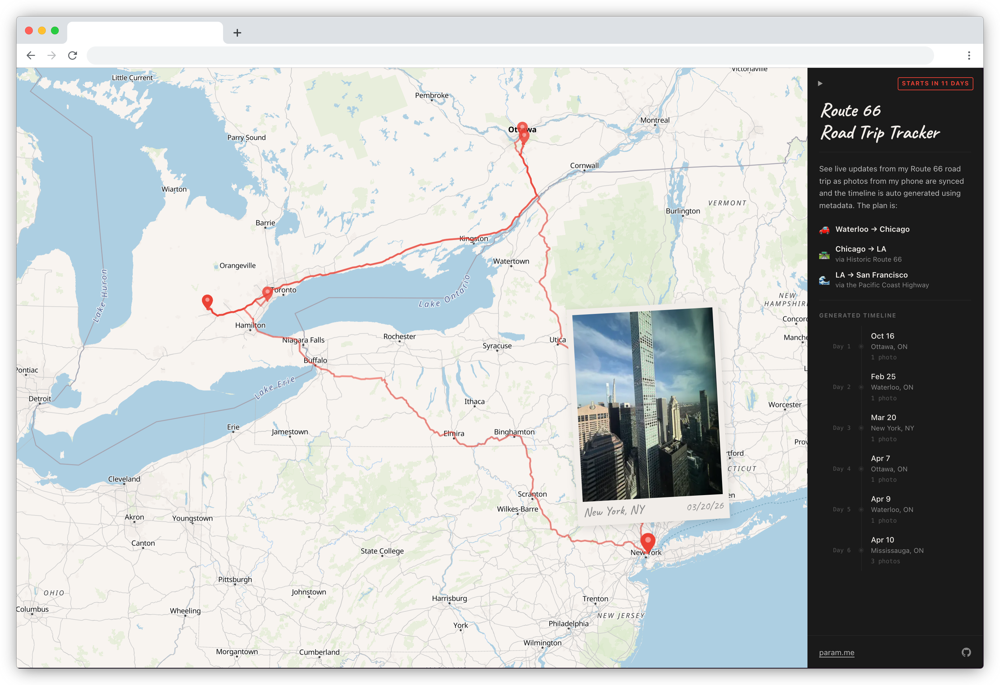

# Route 66 Road Trip Map

> A live tracker for my road trip from Toronto to SF via Route 66

Syncs with photos from my phone to generate an interactive map with polaroid popups, an interpolated route, a day-by-day timeline, and live trip status. [Copy this for your own trips!](#set-up-for-your-own-trip)





Built with React + MapLibre GL JS + OpenFreeMap tiles

## Set up for your own trip

### 1. Fork the repo

[Fork this repo](https://github.com/paramt/route-66/fork) on GitHub.

### 2. Enable GitHub Pages

Go to your repo's **Settings → Pages** and set the source to **GitHub Actions**.

### 3. Add your OpenRouteService API key

Sign up for a free key at [openrouteservice.org](https://openrouteservice.org/), then add it as a repository secret named `ORS_API_KEY` under **Settings → Secrets → Actions**.

This is used to snap your route to actual roads. Without it, the map falls back to straight lines between photos.

### 4. Update trip metadata

Edit `src/trip.config.js`:

- `TRIP_START` / `TRIP_END` — your trip dates (drives the live/upcoming/ended badge)
- `TRIP_LEGS` — the named legs shown in the sidebar

### 5. Add your photos and push

Drop GPS-tagged photos (JPG, HEIC, or PNG) into `public/photos/` and push to `main`. Any photo taken on a modern iPhone or Android with location enabled will have GPS data.

GitHub Actions handles the rest automatically: it extracts EXIF metadata, generates thumbnails, fetches the road-snapped route, builds the site, and deploys it to GitHub Pages. The route also re-fetches hourly — useful if you're adding photos mid-trip.

---

## Local development

> You don't need to do any of this — CI handles everything automatically when you push. This is just for previewing changes locally.

```bash
npm install
npm run dev
```

To process photos locally (useful for previewing before pushing):

```bash
npm run process          # extract EXIF, generate thumbnails → src/data/photos.json
ORS_API_KEY=... npm run update-route  # fetch road-snapped route → src/data/route.json
```

Or put `ORS_API_KEY=your_key` in a `.env` file and run `npm run update-route` directly.

---

## Tech stack

| Piece | What it does |
|---|---|
| React + Vite | UI framework and build tool |
| MapLibre GL JS | WebGL map rendering |
| OpenFreeMap | Free map tiles (no API key needed) |
| OpenRouteService | Road-snapped routing (free tier) |
| Nominatim | Reverse geocoding (free, no key needed) |
| sharp + heic-convert | Thumbnail generation and HEIC conversion |
| exifr | EXIF metadata extraction |
| GitHub Pages | Hosting |
| GitHub Actions | CI/CD: process photos, fetch route, deploy |

---

## Project structure

```
public/photos/        ← drop your photos here
src/
  data/
    photos.json       ← generated automatically by CI
    route.json        ← generated automatically by CI
  components/
    WorldMap.jsx      ← MapLibre map, markers, route layers
    Polaroid.jsx      ← photo card component
    Tack.jsx          ← map marker pin
  App.jsx             ← main app, sidebar, timeline, state
scripts/
  process.js          ← photo processing script
  update-route.js     ← route fetching script
.github/workflows/
  deploy.yml          ← build + deploy on push
  update-route.yml    ← re-fetch route every hour
```

---

## Notes

- Photos without GPS are included in the sidebar timeline but not plotted on the map
- HEIC files are automatically converted to JPG during processing; the originals are not deleted
- The route is cached by a hash of your waypoints — it only re-fetches from ORS when photos change
- The free ORS tier supports up to ~50 waypoints per request; the script batches automatically for longer trips
- Sidebar stats (Photos, Cities, States/Provinces) come from `photos.json`; Distance Covered comes from `route.json`. If ORS has never succeeded, the stats section is hidden. If ORS fails on a re-run, the previous distance and route are shown unchanged — stale but consistent
